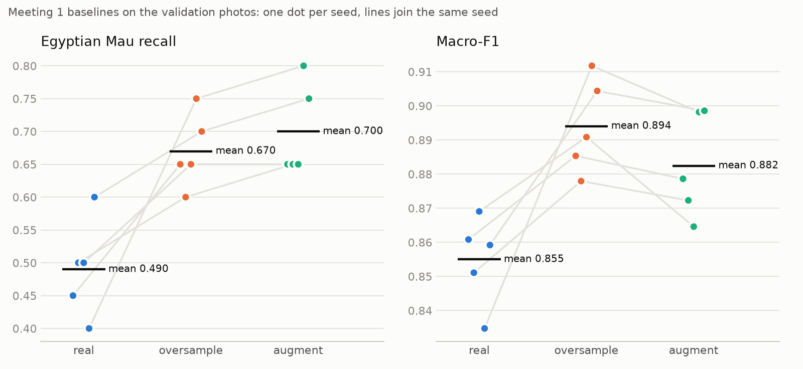
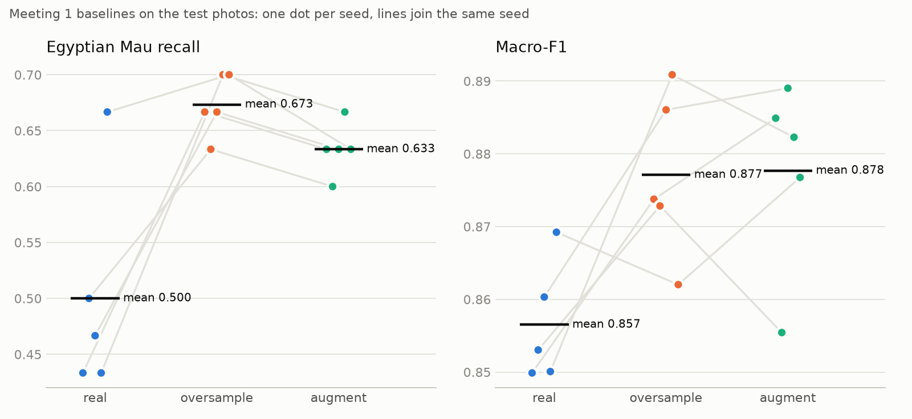
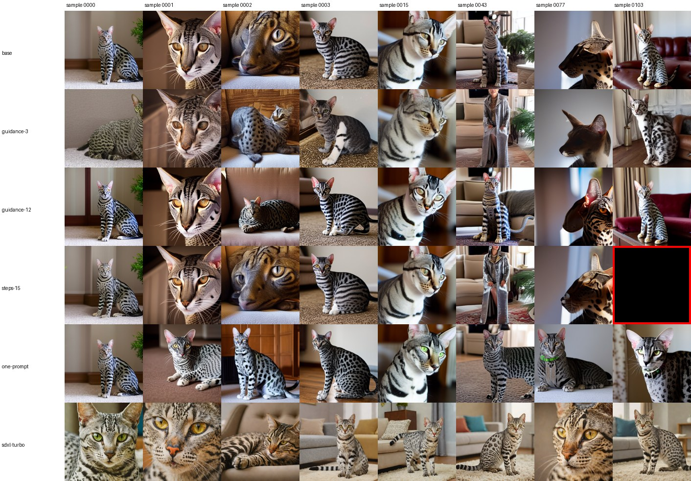
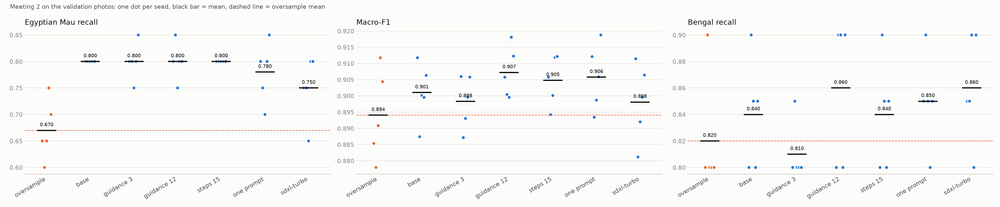
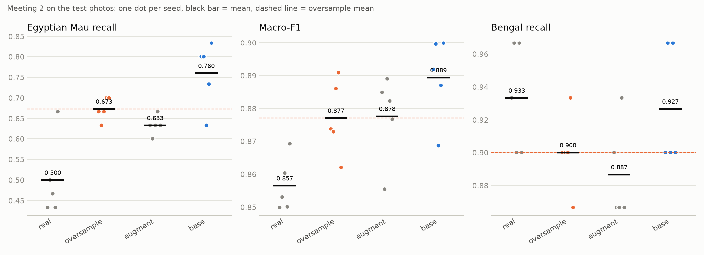

# Experiment Log

Keep one section per meeting. Add the tables and plots you make from
`runs/*/results.json` and `test-results.json` (save the plots in `evidence/`),
link the pools' contact sheets, and explain what you see. A result that shows no
effect is still a result: say so and say why.

## Meeting 1 — Real-data baselines

- **Question:** How much do oversampling and ordinary augmentation help Egyptian
  Mau recall compared with the imbalanced data?
- **How `oversample()` works:** 55 = 3 × 15 + 10, so every one of the 15 photos
  is repeated 3 times and `rng.sample` picks 10 different photos for a fourth
  repeat. Each photo is added 3 or 4 times, and the order is shuffled with `rng`,
  so the seed reproduces the list. I checked this for seeds 0–4: 10 photos are
  added 4 times, 5 photos 3 times. The copies are not identical at training time,
  because `TRAIN_TRANSFORM` (crop, flip, mild colour jitter) still runs on every
  photo. So `oversample` is already a mildly augmented baseline.
- **How `augment()` works, and why these transforms:** it runs on the 55 added
  copies only, before `TRAIN_TRANSFORM`, and draws a new variant every epoch:
  - rotation up to ±15°, which the pipeline lacks; cats are photographed tilted;
  - a stronger crop (scale 0.6–1.0, ratio 0.8–1.25) for other framing and
    distance, since the pipeline only goes down to 0.75;
  - brightness and contrast ±0.3 and saturation ±0.2 for other lighting;
  - a light Gaussian blur (20% of the time) for soft or low-quality photos.

  Hue stays fixed and saturation changes less, because coat colour and spots are
  what identifies the breed. No vertical flips: upside-down cats are not in the
  data. [Examples](evidence/m1-augment-examples.jpg) (first column is the
  original): the cats stay recognisable, but rotation leaves black corners, and
  the crop can lose the head (row 2, column 4).
- **Commands:**

  ```bash
  uv run synth-train --name m1-real --method real
  uv run synth-train --name m1-oversample --method oversample
  uv run synth-train --name m1-augment --method augment
  uv run python evidence/m1_report.py val
  ```

- **Results on validation:** 5 seeds, 20 Egyptian Mau photos, so one photo is
  0.05 of recall.

  | Seed | Mau recall: real | oversample | augment | Macro-F1: real | oversample | augment |
  | --- | ---: | ---: | ---: | ---: | ---: | ---: |
  | 0 | 0.450 | 0.650 | 0.650 | 0.861 | 0.885 | 0.879 |
  | 1 | 0.500 | 0.600 | 0.650 | 0.851 | 0.878 | 0.872 |
  | 2 | 0.500 | 0.650 | 0.650 | 0.869 | 0.891 | 0.865 |
  | 3 | 0.400 | 0.750 | 0.800 | 0.835 | 0.912 | 0.898 |
  | 4 | 0.600 | 0.700 | 0.750 | 0.859 | 0.904 | 0.899 |
  | **Mean** | **0.490** | **0.670** | **0.700** | **0.855** | **0.894** | **0.882** |
  | SD | 0.074 | 0.057 | 0.071 | 0.013 | 0.014 | 0.015 |

  | Mean over seeds | real | oversample | augment |
  | --- | ---: | ---: | ---: |
  | Mean recall of the other 7 breeds | 0.914 | 0.929 | 0.911 |
  | Bengal recall | 0.840 | 0.820 | 0.720 |
  | Other breeds' photos called Egyptian Mau | 0.2 | 1.2 | 3.0 |
  | Egyptian Mau precision | 0.985 | 0.919 | 0.824 |

  

  Files: [per seed](evidence/m1-val-seeds.csv),
  [summary](evidence/m1-val-summary.csv),
  [paired differences](evidence/m1-val-differences.csv),
  [recall per breed](evidence/m1-val-breed-recall.csv),
  [per Mau photo](evidence/m1-val-mau-photos.csv).
- **What I see:**
  - **Balancing helps a lot.** Against `real`, recall rises in all 5 seeds with
    both methods: +0.18 with `oversample` (+0.10 to +0.35) and +0.21 with
    `augment` (+0.15 to +0.40), so about 4 more of the 20 photos.
  - **`augment` does not clearly beat `oversample` on recall.** The gap is +0.03,
    or 0.6 of a photo; `augment` is ahead in 3 seeds and tied in 2. This is too
    small to call with 20 photos and 5 seeds.
  - **`augment` costs more elsewhere.** Macro-F1 is lower than `oversample` in
    all 5 seeds (−0.012 on average), and so is the recall of the other breeds
    (−0.017). In seed 2 its macro-F1 is even below `real` (0.865 vs 0.869).
  - **The cost is Bengal.** Mau and Bengal are both spotted. `real` calls 5.0 Mau
    photos Bengal per seed; balancing cuts this to about 2, but moves the boundary
    the other way: Bengal photos called Mau go 0.2 → 1.2 → 3.0, and Bengal recall
    falls to 0.720 with `augment`. On validation, `oversample` has the best
    trade-off: nearly the same recall, and no measurable harm to the other breeds
    on average (+0.014), though Bengal itself drops slightly (−0.02).
  - **Some photos stay unsolved.** Of 20 photos, 8 are right in all 15 models, and
    3 in none ([sheet](evidence/m1-val-hard-mau.jpg): `Egyptian_Mau_15`, `_155`,
    `_131`; the bottom-right three are easy ones). By eye, the easy ones show a
    whole silver cat with clear spots, while the hard ones show a small cat in a
    room, a warm-coloured head close-up, or a curled-up bronze cat. My guess is
    that the 15 training photos do not cover these looks, and re-using those same
    photos cannot add them. I have not tested this; it is what synthetic images
    could try to fix.
  - **Limits.** Seeds change training only, not the 20 photos, so the spread
    between seeds understates the real uncertainty. Also, 560 training photos give
    9 batches per epoch and 505 give 8 (72 vs 64 steps), so `real` gets slightly
    less training; part of the gain could come from this, not only from balance.
  - **Expectation before testing:** both methods beat `real` on recall;
    `oversample` keeps the higher macro-F1. All three baselines go to test, as the
    README asks, so no choice is needed here.
- **Test results of the three baselines:** every seed of all three runs, on the
  240 test photos. There are 30 Egyptian Mau photos, so one photo is 0.033 of
  recall. These are the reference for the later meetings.

  ```bash
  uv run synth-test --run m1-real
  uv run synth-test --run m1-oversample
  uv run synth-test --run m1-augment
  uv run python evidence/m1_report.py test
  ```

  | Seed | Mau recall: real | oversample | augment | Macro-F1: real | oversample | augment |
  | --- | ---: | ---: | ---: | ---: | ---: | ---: |
  | 0 | 0.433 | 0.667 | 0.633 | 0.850 | 0.874 | 0.885 |
  | 1 | 0.500 | 0.633 | 0.600 | 0.853 | 0.873 | 0.855 |
  | 2 | 0.467 | 0.667 | 0.633 | 0.860 | 0.886 | 0.889 |
  | 3 | 0.433 | 0.700 | 0.667 | 0.850 | 0.891 | 0.882 |
  | 4 | 0.667 | 0.700 | 0.633 | 0.869 | 0.862 | 0.877 |
  | **Mean** | **0.500** | **0.673** | **0.633** | **0.857** | **0.877** | **0.878** |
  | SD | 0.097 | 0.028 | 0.024 | 0.008 | 0.011 | 0.013 |

  | Mean over seeds | real | oversample | augment |
  | --- | ---: | ---: | ---: |
  | Mean recall of the other 7 breeds | 0.914 | 0.908 | 0.915 |
  | Bengal recall | 0.933 | 0.900 | 0.887 |
  | Other breeds' photos called Egyptian Mau | 0.0 | 0.2 | 1.0 |
  | Egyptian Mau precision | 1.000 | 0.991 | 0.950 |

  

  Files: [per seed](evidence/m1-test-seeds.csv),
  [summary](evidence/m1-test-summary.csv),
  [paired differences](evidence/m1-test-differences.csv),
  [recall per breed](evidence/m1-test-breed-recall.csv),
  [per Mau photo](evidence/m1-test-mau-photos.csv).

  - **The main result holds.** Balancing raises recall by about 0.13–0.17: +0.173
    with `oversample` (up in all 5 seeds) and +0.133 with `augment` (up in 4; in
    seed 4 it is below `real`, 0.633 vs 0.667). Macro-F1 rises by 0.021 with both,
    less than the +0.03 to +0.04 on validation.
  - **The order of `oversample` and `augment` on recall flipped.** On validation
    `augment` led by 0.03; on test `oversample` leads by 0.04, in all 5 seeds. This
    fits the validation note that the gap was too small to call. Ordinary
    augmentation shows no recall advantage over repeating the photos.
  - **My expectation was half right.** Both methods beat `real` on mean recall, but
    `oversample` did not keep the higher macro-F1: the two are tied (0.877 vs
    0.878).
  - **The Bengal harm is much smaller on test.** The direction is the same: Bengal
    recall 0.933 → 0.900 → 0.887, and Bengal photos called Mau 0 → 0.2 → 0.6. But
    the other breeds overall barely move (0.914, 0.908, 0.915). So the large
    validation drop was at least partly specific to those 20 Bengal photos.
  - **Mau is still the weakest breed.** The best baseline finds about 20 of 30
    photos, and most misses go to Bengal (4.2 per seed with `oversample`) and
    Russian Blue (4.2). Seven photos are missed by all 15 models and 10 are found
    by all 15, so, as on validation, a fixed group of photos stays out of reach of
    methods that re-use the same 15 photos.
  - **Reference for later meetings:** Egyptian Mau recall 0.673 and macro-F1 0.877
    (`oversample`). A synthetic method has to beat this, not only `real`.

## Meeting 2 — Text-to-image generation

- **Question:** Can 55 Egyptian Mau images generated from text alone beat
  `oversample` (validation Mau recall 0.670, macro-F1 0.894), and which
  generation setting matters?
- **Prompts:** Meeting 1 left a fixed group of Mau photos unsolved, and by eye
  they were a small cat in a room, a warm-coloured head close-up, and a curled-up
  bronze cat. So `m2-base` cycles through four prompts, one aimed at each of those
  looks plus one "typical" silver Mau (image *i* uses prompt *i* mod 4):

  1. `a photo of an Egyptian Mau cat, silver coat with distinct black spots, green eyes, sitting indoors`
  2. `close-up photo of the head of an Egyptian Mau cat, spotted coat, warm light`
  3. `a photo of a bronze Egyptian Mau cat curled up on a sofa, spotted coat`
  4. `a small Egyptian Mau cat in a living room, full body, spotted silver coat`

  Negative prompt: the default (`illustration, painting, cartoon, text,
  watermark, multiple cats, deformed animal, extra limbs`).
- **Setting changed in each pool (one at a time):** every pool uses the same
  prompts and the same seeds (1000 + *i*), so image *i* of one pool is the
  "same" image as image *i* of another, with one setting changed.

  | Pool | Changed from `m2-base` | Why |
  | --- | --- | --- |
  | `m2-base` | – (SD 1.5, DPM, 30 steps, guidance 7.5) | starting point |
  | `m2-guidance-3` | guidance 7.5 → 3 | looser, more varied images? |
  | `m2-guidance-12` | guidance 7.5 → 12 | follows the prompt more strictly |
  | `m2-steps-15` | 30 → 15 steps | does a cheaper sampler lose quality? |
  | `m2-one-prompt` | four prompts → prompt 1 only | does prompt variety matter? |
  | `m2-sdxl-turbo` | SD 1.5 → SDXL-Turbo (4 steps, guidance 0) | another, more photographic model |

- **Commands:** generation and training ran on Google Colab (T4), with
  [m2_colab.ipynb](m2_colab.ipynb). `PROMPTS` stands for the four `--prompt`
  options above.

  ```bash
  uv run synth-generate --name m2-base $PROMPTS
  uv run synth-train --name m2-base --method synthetic --pool m2-base --tag model=sd15
  uv run synth-generate --name m2-guidance-3 $PROMPTS --guidance 3
  uv run synth-train --name m2-guidance-3 --method synthetic --pool m2-guidance-3 --tag guidance=3
  uv run synth-generate --name m2-guidance-12 $PROMPTS --guidance 12
  uv run synth-train --name m2-guidance-12 --method synthetic --pool m2-guidance-12 --tag guidance=12
  uv run synth-generate --name m2-steps-15 $PROMPTS --steps 15
  uv run synth-train --name m2-steps-15 --method synthetic --pool m2-steps-15 --tag steps=15
  uv run synth-generate --name m2-one-prompt --prompt "<prompt 1>"
  uv run synth-train --name m2-one-prompt --method synthetic --pool m2-one-prompt --tag prompts=1
  uv run synth-generate --name m2-sdxl-turbo $PROMPTS --model sdxl-turbo
  uv run synth-train --name m2-sdxl-turbo --method synthetic --pool m2-sdxl-turbo --tag model=sdxl-turbo
  uv run python evidence/m2_report.py val
  uv run python evidence/m2_report.py sheet
  ```

- **Contact sheets:** [base](pools/m2-base/contact-sheet.jpg),
  [guidance 3](pools/m2-guidance-3/contact-sheet.jpg),
  [guidance 12](pools/m2-guidance-12/contact-sheet.jpg),
  [steps 15](pools/m2-steps-15/contact-sheet.jpg),
  [one prompt](pools/m2-one-prompt/contact-sheet.jpg),
  [SDXL-Turbo](pools/m2-sdxl-turbo/contact-sheet.jpg). I looked at all 110
  images of every pool, not only the first 24.
  [Same seeds in every pool](evidence/m2-pools-same-seeds.jpg) (one row per
  pool, one column per image number) shows what each setting changes.

  

  What the images look like, and the failure types I name:
  - **Good:** prompt 1 and prompt 4 in SD 1.5 give silver cats with black spots,
    large ears and often green eyes, close to the real breed (`m2-base` 0000,
    0003, 0064, 0080, 0103). Prompt 4 really gives small cats in a room, which
    the training photos lack.
  - **Stripes instead of spots (tabby):** the most common failure. Many cats have
    mackerel-tabby stripes on the body or legs, which the real breed does not
    (`m2-base` 0030, 0066, 0015). It is worst for prompt 3 ("bronze … curled
    up"): "bronze" turns into an ordinary brown tabby on a sofa.
  - **Bengal / leopard look:** large dark blotches or rosettes instead of small
    spots (`m2-base` 0028, 0072, 0091). This is the dangerous failure, because
    Bengal is the breed Mau is confused with.
  - **Wrong eyes in close-ups:** prompt 2 gives yellow-amber eyes and heavy dark
    face stripes instead of green eyes; some are extreme close-ups of one eye
    (0017, 0037).
  - **Deformed or no cat:** a melted head (0077), a cat merged with a leopard
    blanket (0069), two cats despite the negative prompt (0027). Image 0043 in
    `m2-guidance-3` and `m2-steps-15` is a person in a long coat, not a cat.
  - **Blocked:** `m2-steps-15` 0103 came out black (safety filter), so that pool
    has 109 usable images; the run still draws 55.

  What each setting changes, by eye:
  - **Guidance 3:** softer, less saturated images, weaker and fuzzier spots, more
    ordinary grey tabbies and more broken anatomy (two cats, the person).
  - **Guidance 12:** the same compositions as `m2-base` but sharper and more
    contrasted; spots are bolder and the coat looks more like a Mau.
  - **Steps 15:** almost indistinguishable from `m2-base`, with the same seeds.
  - **One prompt:** the most "textbook" pool — nearly all silver spotted cats
    with green eyes — but no close-ups, no bronze cats and fewer small cats.
  - **SDXL-Turbo:** the most photographic, but almost no variety: each prompt
    gives nearly the same image every time (same pose, same framing, same
    living room). Prompts 2 and 3 give brown tabbies with yellow eyes rather than
    Mau.

- **Results on validation:** 5 seeds, 20 Egyptian Mau photos (one photo =
  0.05 recall).

  | Seed | oversample | base | guidance 3 | guidance 12 | steps 15 | one prompt | sdxl-turbo |
  | --- | ---: | ---: | ---: | ---: | ---: | ---: | ---: |
  | 0 | 0.650 | 0.800 | 0.800 | 0.800 | 0.800 | 0.800 | 0.750 |
  | 1 | 0.600 | 0.800 | 0.800 | 0.850 | 0.800 | 0.750 | 0.750 |
  | 2 | 0.650 | 0.800 | 0.750 | 0.750 | 0.800 | 0.700 | 0.650 |
  | 3 | 0.750 | 0.800 | 0.800 | 0.800 | 0.800 | 0.800 | 0.800 |
  | 4 | 0.700 | 0.800 | 0.850 | 0.800 | 0.800 | 0.850 | 0.800 |
  | **Mau recall** | **0.670** | **0.800** | **0.800** | **0.800** | **0.800** | **0.780** | **0.750** |
  | SD | 0.057 | 0.000 | 0.035 | 0.035 | 0.000 | 0.057 | 0.061 |
  | **Macro-F1** | **0.894** | **0.901** | **0.898** | **0.907** | **0.905** | **0.906** | **0.898** |
  | Other 7 breeds' recall | 0.929 | 0.916 | 0.913 | 0.923 | 0.920 | 0.924 | 0.920 |
  | Bengal recall | 0.820 | 0.840 | 0.810 | 0.860 | 0.840 | 0.850 | 0.860 |
  | Other photos called Mau | 1.2 | 1.0 | 1.6 | 0.4 | 1.0 | 1.0 | 0.8 |
  | Mau precision | 0.919 | 0.941 | 0.910 | 0.976 | 0.941 | 0.940 | 0.952 |

  

  Files: [per seed](evidence/m2-val-seeds.csv),
  [summary](evidence/m2-val-summary.csv),
  [paired differences](evidence/m2-val-differences.csv),
  [recall per breed](evidence/m2-val-breed-recall.csv),
  [per Mau photo](evidence/m2-val-mau-photos.csv).

- **What I see:**
  - **Text-to-image clearly beats `oversample` on Mau recall.** Every SD 1.5
    pool reaches 0.800, +0.13 over `oversample` (about 2.6 more of the 20
    photos), and is ahead in all 5 seeds. Macro-F1 also rises slightly (+0.004
    to +0.013), so the gain does not come from calling everything Mau: Mau
    precision is higher and Bengal recall does not fall, except for guidance 3
    (precision 0.910 vs 0.919, Bengal −0.01).
  - **The gain is on specific photos.** `Egyptian_Mau_15` (the small cat in a
    room, missed by every Meeting 1 model) is now right in 5/5 seeds with
    `m2-base`; `_11` and `_148` go from 1/5 and 2/5 to 5/5. This fits the
    reason for prompt 4. `_131` and `_155` stay wrong in every run, as in
    Meeting 1: the warm head close-up and the curled-up bronze cat are exactly
    the prompts that the model drew worst (yellow-eyed tabbies), so it is no
    surprise they did not help.
  - **Fewer Mau photos called Russian Blue or Abyssinian** (2.0 → 1.0 each per
    seed), while confusion with Bengal barely moves (2.4 → 2.0).
  - **The SD 1.5 settings barely matter.** Guidance 3, guidance 12 and 15 steps
    all give the same mean recall (0.800); the differences in macro-F1 (≤0.006
    from `m2-base`) are below one photo and change sign between seeds. Guidance
    12 has the best macro-F1, Bengal recall and Mau precision, but by 0.4–1
    photo per seed. Guidance 3 is the only one slightly worse on every metric,
    which matches its weaker spots and broken images. 15 steps changes nothing
    measurable, so the cheaper sampler is enough.
  - **Variety matters more than image quality.** SDXL-Turbo gives the most
    photographic images but the lowest recall (0.750, −0.05 vs `m2-base`, down
    in 3 seeds, never up), and one prompt is also lower (0.780, more spread).
    Both pools are less varied — SDXL-Turbo nearly repeats one image per
    prompt — so 55 images carry less new information than 55 varied ones.
  - **Limits.** As in Meeting 1, 20 photos and 5 training seeds; also, all
    pools share one generation seed range, so a second set of generated images
    could move the small differences between settings.

- **Pool I take forward, and why:** `m2-base`. On validation the four SD 1.5
  pools tie on Mau recall (0.800), and `m2-base` is the most stable one (0.800
  in all 5 seeds). The differences in macro-F1 between them are smaller than
  one photo and not consistent across seeds, so none of the changed settings is
  shown to be better than the defaults; I keep the default setting rather than
  pick the highest mean from noise.

- **Its test result, compared with the baselines:** 30 Egyptian Mau test photos
  (one photo = 0.033 recall).

  ```bash
  uv run synth-test --run m2-base
  uv run python evidence/m2_report.py test
  ```

  | Seed | Mau recall: real | oversample | augment | **m2-base** | Macro-F1: real | oversample | augment | **m2-base** |
  | --- | ---: | ---: | ---: | ---: | ---: | ---: | ---: | ---: |
  | 0 | 0.433 | 0.667 | 0.633 | 0.800 | 0.850 | 0.874 | 0.885 | 0.892 |
  | 1 | 0.500 | 0.633 | 0.600 | 0.800 | 0.853 | 0.873 | 0.855 | 0.900 |
  | 2 | 0.467 | 0.667 | 0.633 | 0.633 | 0.860 | 0.886 | 0.889 | 0.869 |
  | 3 | 0.433 | 0.700 | 0.667 | 0.733 | 0.850 | 0.891 | 0.882 | 0.887 |
  | 4 | 0.667 | 0.700 | 0.633 | 0.833 | 0.869 | 0.862 | 0.877 | 0.900 |
  | **Mean** | **0.500** | **0.673** | **0.633** | **0.760** | **0.857** | **0.877** | **0.878** | **0.889** |
  | SD | 0.097 | 0.028 | 0.024 | 0.080 | 0.008 | 0.011 | 0.013 | 0.013 |

  | Mean over seeds | real | oversample | augment | m2-base |
  | --- | ---: | ---: | ---: | ---: |
  | Other 7 breeds' recall | 0.914 | 0.908 | 0.915 | 0.909 |
  | Bengal recall | 0.933 | 0.900 | 0.887 | 0.927 |
  | Other photos called Mau | 0.0 | 0.2 | 1.0 | 0.8 |
  | Mau precision | 1.000 | 0.991 | 0.950 | 0.964 |
  | Mau photos called Bengal | 9.0 | 4.2 | 4.8 | 4.0 |
  | Mau photos called Russian Blue | 5.2 | 4.2 | 4.4 | 2.2 |

  

  Files: [per seed](evidence/m2-test-seeds.csv),
  [summary](evidence/m2-test-summary.csv),
  [paired differences](evidence/m2-test-differences.csv),
  [recall per breed](evidence/m2-test-breed-recall.csv),
  [per Mau photo](evidence/m2-test-mau-photos.csv).

  - **The gain holds on test, but smaller.** Mau recall 0.760 vs 0.673 for
    `oversample`: +0.087, about 2.6 more of the 30 photos, against +0.13 on
    validation. It is up in 4 of 5 seeds; in seed 2 it is 0.633, one photo below
    `oversample`. The spread between seeds is much larger than on validation
    (SD 0.080 vs 0.000), so the synthetic images make training less stable on
    these photos.
  - **No harm to the other breeds.** Macro-F1 is the best of all runs so far
    (0.889, +0.012 vs `oversample`, up in 3 of 5 seeds), the other breeds' recall
    is unchanged (0.909 vs 0.908), and Bengal recall is even higher (0.927 vs
    0.900). Mau precision drops a little (0.991 → 0.964, 0.6 more false Mau per
    seed).
  - **Where the gain comes from:** mostly Mau photos no longer called Russian
    Blue (4.2 → 2.2 per seed); confusion with Bengal stays (4.2 → 4.0). Several
    photos missed by every Meeting 1 model are now sometimes found
    (`Egyptian_Mau_21`, `_47`, `_51`, `_70`), but three (`_215`, `_58`, `_69`)
    are still missed by every model.
  - **New reference for later meetings:** Mau recall 0.760, macro-F1 0.889
    (`m2-base`).

## Meeting 3 — Generation from training photos

- **Question:** How close to the real photos should the synthetic images be?
- **img2img strength values and IP-Adapter scale values tried:**
- **Commands:**
- **Contact sheets:**
- **Results on validation:**
- **What I see:**
- **Best run of each mode, and its test result:**

## Meeting 4 — Editing training photos

- **Question:** Does the classifier need new cats or new backgrounds?
- **Background prompts and outpainting scales tried:**
- **Commands:**
- **Contact sheets:**
- **Results on validation:**
- **What I see:**
- **Best run of each mode, and its test result:**

## Final comparison

- **Runs chosen in Meetings 1–4:**
- **Results:** (your table and plot of their `test-results.json`)
- **Did the validation ranking hold on the test photos?**
- **Recommendation:** use, revise, or reject synthetic data for this task.
